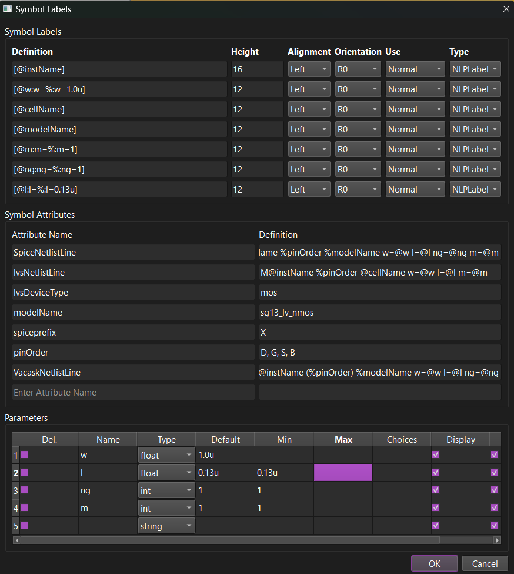
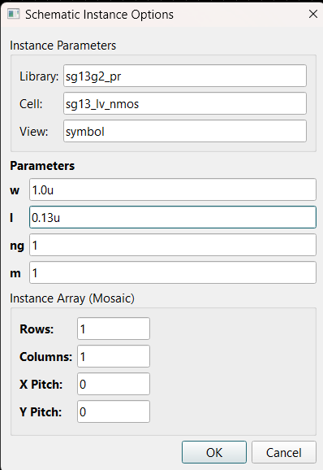
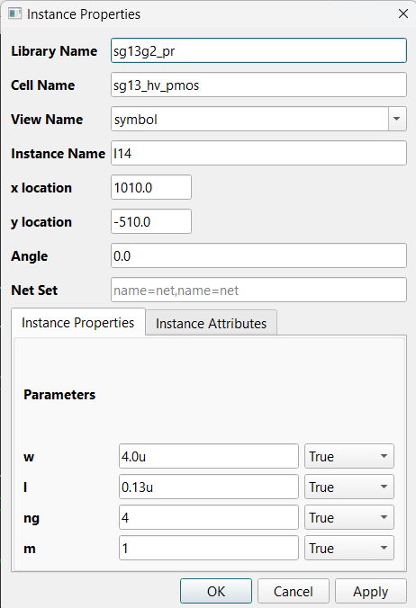

# Symbol Parameters (paramDefs)

Revolution EDA supports **typed instance parameters** on symbols, as a
lightweight CDF system. A symbol *author* declares which labels are editable
parameters, their types, defaults, and limits; a schematic *user* then edits
those values through typed controls when placing or editing instances.

This document covers both sides:

- **Schematic users**: see [Editing instance parameters](#editing-instance-parameters).
- **Symbol/PDK authors**: see [Declaring parameters on a symbol](#declaring-parameters-on-a-symbol).

## Labels vs. typed parameters

A symbol label can display an instance value without declaring a typed
parameter. The two layers are independent:

| Concept | What it is for | Where it is defined |
|---|---|---|
| **Symbol label** | Visible text, an instance value carrier, or a computed display | Symbol graphics |
| **Typed parameter** | An explicit declaration of an editable, validated value | Reserved symbol attribute `paramDefs` |

The same instance uses both layers together. A typed parameter does not create
its own storage — it *enriches* an existing **NLP label** on the symbol with a
type, a default, and validation rules. Each parameter declaration must match a
value-carrying NLP label named `@<name>` (preferred) or a legacy bare `<name>`
NLP label. A declaration without a matching carrier is ignored by the editing
forms and reported as a warning when the instance options form opens.

> Keeping declarations separate from labels means PDK and legacy symbols keep
> working unchanged: labels carry and display values, while `paramDefs`
> formalize which of them are user-editable inputs and how they are validated.

### Label types on a symbol

- **Normal labels** — fixed annotation text (technology name, notes). Not
  parameters; shown read-only in instance forms.
- **NLP labels** — `[@name:format:default]` definitions that carry an editable
  instance value. These are the only labels a `paramDefs` entry can bind to.
  See [Labels](./labels.md) for the syntax.
- **PyLabels** — values computed by a PDK callback from the instance's other
  labels. Always read-only; they appear under **Derived Parameters** and
  refresh live as inputs change.

## Declaring parameters on a symbol

Parameter definitions live in a reserved symbol attribute named `paramDefs`.
You never edit it as raw JSON — the symbol editor manages it through a table.

1. Open the cell's **symbol** view in the Symbol Editor.
2. Make sure every value you want to expose already has an NLP label on the
   symbol, e.g. `[@w:W=%:W=1u]` for a width parameter named `w`.
3. Open **Edit → Cellview Properties...**.
4. In the **Parameters** table, add one row per parameter. Typing a name in
   the empty last row appends a new row automatically; tick **Del.** to remove
   a row.
5. Save the symbol. Reload any open schematic that uses it before placing new
   instances.



<!-- *Screenshot needed: the symbol editor's **Cellview Properties** dialog showing
the **Parameters** group filled in for a MOSFET (rows for `w`, `l`, `nf`, and a
`model` choice parameter), with the Symbol Labels and Symbol Attributes groups
visible above it for context.* -->

### Parameters table columns

| Column | Meaning |
|---|---|
| **Name** | Parameter name. Must match an NLP label `@name` (or bare `name`). |
| **Type** | `float`, `int`, `string`, `boolean`, or `choice`. |
| **Default** | Value used when the instance field is empty. Overrides the NLP label's literal default and may contain `pPar("other")` references (see below). |
| **Min / Max** | Optional numeric bounds for `float` and `int`. |
| **Choices** | Comma-separated allowed values; required for `choice`. |
| **Display** | Unchecked hides the parameter from editing forms. Hidden parameters stay defined, keep their stored value across edits, and are still validated. |
| **Parse** | Allows SI suffixes (`1k`, `2u`, `130n`) in numeric values and bounds. |

A `paramDefs` entry is stored on the symbol roughly as:

```json
{"name": "w", "type": "float", "default": "1u",
 "min": "0.12u", "display": true, "parse": true}
```

Prefer the table over hand-editing this JSON. Structural problems — duplicate
names, a `choice` with no choices, an unparseable bound, `min` greater than
`max`, or an invalid literal default — are logged as warnings when the symbol
is saved and shown as a table tooltip in the dialog.

### Defaults and `pPar()` references

A default may reference sibling parameter values with `pPar("name")`, the same
convention PyLabels use:

```json
{"name": "totalW", "type": "float", "default": "pPar(\"w\")*pPar(\"nf\")"}
```

References resolve against the instance's other label values — including
hidden (`Display` off) parameters — and may chain through other references.
Unresolvable references are left literal rather than failing silently.
`pPar()` is also accepted in values you type into a form field; the value is
resolved before type and range checks.

## Editing instance parameters

### Placement options form (F3)

When you run **Create → Instance...** and pick a cellview, the **Schematic
Instance Options** form opens automatically before placement starts. Press
**F3** at any time while placing to reopen it. Values entered here are
remembered for the whole placement run.



<!-- *Screenshot needed: the placement options form for a MOSFET, showing the
Library/Cell/View header, a **Parameters** section with typed rows (a checkbox
for a boolean, a drop-down for the `model` choice, line edits for `w`/`l`/`nf`),
an **Instance Parameters** section, a read-only **Derived Parameters** row, and
the **Instance Array (Mosaic)** group at the bottom.* -->

Rows are grouped into sections, in this order:

| Section | Contents | Editable? |
|---|---|---|
| **Parameters** | Typed parameters bound by `paramDefs`, in declaration order | Yes, with typed widgets |
| **Instance Parameters** | NLP labels without a parameter declaration | Yes, as plain text (untyped) |
| **Normal Labels** | Literal annotation labels | No |
| **Derived Parameters** | PyLabels computed by PDK callbacks | No — refresh live as you edit |

Widget types follow the declaration: **boolean** becomes a checkbox,
**choice** a drop-down, and everything else a line edit whose tooltip shows
the type, bounds, and whether SI suffixes are allowed.

Clicking **OK** validates every typed field (type, min/max, choices). If any
value is invalid, a warning lists all errors and the form stays open so you
can correct them — nothing invalid is committed.

The form also contains the **Instance Array (Mosaic)** controls — Rows,
Columns, X Pitch, Y Pitch — for placing the instance as an array. Leave them
at the defaults for a single instance.

### Instance Properties on a placed instance

Selecting an instance and choosing **Edit → Object Properties...** (or the
equivalent context action) opens the **Instance Properties** dialog. It shows
the same parameter sections, plus a per-row **Visible** column that toggles
whether each label is drawn next to the instance.



<!-- *Screenshot needed: the Instance Properties dialog for a placed MOSFET
instance, showing the Library Name/Cell Name/View Name/Instance Name/location
fields at the top, then the Parameters, Instance Parameters, Normal Labels,
and Derived Parameters sections each with a value field and a Visible
True/False drop-down.* -->

- **Apply** recomputes Derived Parameters immediately without committing —
  useful for previewing callback results.
- Invalid typed values are rejected with a warning in the log, and the field
  reverts to the instance's previous value. Valid values are canonicalized
  (e.g. booleans become `true`/`false`).
- Hidden (`Display` off) parameters are not shown; their stored values are
  carried over unchanged.

### Checking a schematic

**Tools → Check Schematic** (Check CellView) validates every instance's stored
values against its symbol's `paramDefs` and reports violations as
`paramValueError` warnings in the error browser alongside connectivity
diagnostics. This catches stale or hand-edited values that bypassed the forms.

## What `paramDefs` does — and does not do

Adding a definition **does**:

- expose a typed control in the placement form and Instance Properties when
  `Display` is enabled;
- validate values during placement, property editing, and Check Schematic;
- provide defaults, including `pPar()` references to sibling values;
- allow SI suffixes (`1k`, `2u`) on numeric parameters when `Parse` is on.

Adding a definition **does not**:

- create a separate parameter store — every typed value still lives on its
  matching NLP label, persisted in the schematic's label data;
- create a missing label carrier — add the `[@name...]` NLP label yourself;
- infer PDK legal limits, PCell parameter mappings, or netlister behavior;
- make a PyLabel or normal label editable.

For a PDK device, keep parameter names aligned with the label names the
PDK's callbacks, netlisters, and layout PCells already expect — those names
are the interoperability contract; `paramDefs` only formalize the user input.

## Troubleshooting

| Symptom | Likely cause | Resolution |
|---|---|---|
| A parameter shows as a plain text field instead of a typed control | Its NLP label exists but there is no matching `paramDefs` row | Add a row in **Cellview Properties → Parameters** with the exact label name (without `@`) |
| "paramDefs without matching NLP labels" warning when placing | A declared parameter has no `@name` (or bare `name`) NLP label carrier | Add the NLP label to the symbol, or remove the stale `paramDefs` row |
| A declared parameter is missing from the forms | `Display` is unchecked, or the carrier is a PyLabel/normal label | Enable **Display**; only NLP labels can carry editable values |
| Numeric input like `1u` is rejected | `Parse` is off, or the value violates `min`/`max`/type | Enable **Parse** for SI suffixes; check the bounds |
| Check Schematic reports `paramValueError` | A stored instance value violates the symbol's definitions | Open Instance Properties on the flagged instance and correct the value |
| PCell, callback, or netlist ignores a new value | The PDK expects a different label name or mapping | Use the label names the PDK expects; fix the PDK mapping only if it is wrong |

See also: [Labels](./labels.md) and [Symbol Editor](./symbolTutorial.md).
