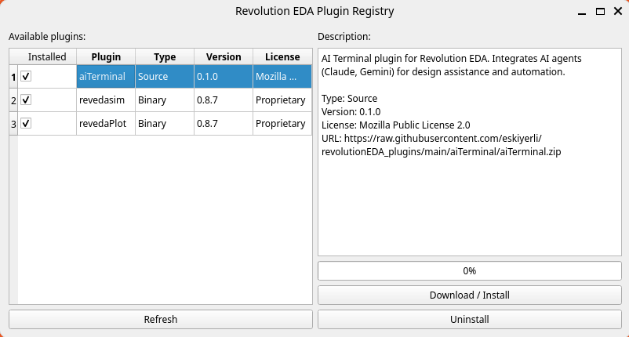

# Revolution EDA Plugins

This guide explains what plugins are in Revolution EDA, how users install and use them, how developers create them, how `config.json` works, and how plugins are published to the Revolution EDA plugin registry.

## Quick Orientation

- Plugins extend Revolution EDA without changing the core application.
- End users typically encounter plugins as extra menu items, new editor actions, or support for
  additional view flows.
- Most users install plugins through `Plugins -> Browse Plugins...`.
- Developers package plugins as Python packages with a `config.json` file and callable
  callback functions.

## What Plugins Are

Plugins are add-ons that extend Revolution EDA without modifying the core application. Typical plugin categories are:

- Simulation workflows
- Result plotting tools
- AI-assisted design tools
- Custom view handlers and editor menu actions

In daily use, plugins usually appear as additional menu actions in editors or as handlers for specific view types.

## How Plugins Are Loaded

At startup, Revolution EDA loads plugins from the directory configured by `REVEDA_PLUGIN_PATH`.

- The loader scans that directory with `pkgutil.iter_modules()`.
- Each discovered package is imported.
- The app logs discovery/load status in `reveda.log`.
- The plugin's `config.json` is read to add menu actions.

Important:
- If `REVEDA_PLUGIN_PATH` is not set, plugins are not loaded by `reveda.py`.
- Use `Plugins -> Browse Plugins...` and application setup paths to configure plugin location.

## Plugin Folder Structure

Each plugin should be a Python package under the plugin directory:

```text
<plugins_path>/
  myPlugin/
    __init__.py
    config.json
    <implementation>.py
    README.md            (recommended)
```

Minimum required files:
- `__init__.py` so Python can import the package
- `config.json` for metadata and menu definitions

## Using Plugins (End Users)

Most users only need three steps:

1. Open the plugin registry UI from `Plugins -> Browse Plugins...`.
2. Install the plugin you want.
3. Restart Revolution EDA.

### Install from Plugin Registry UI

1. Open Plugins Registry Dialogue: `Plugins -> Browse Plugins...`.
2. The Plugin Registry window downloads plugin metadata from:
   `https://plugins.reveda.eu/plugins.json`

 

2. Select a plugin and click `Download / Install`.
3. After a successful installation, choose `Restart Now` to activate it immediately or `Later` to keep working.

Commercial plugins install the required `revedaLicense` module first when it is
not already present. The selected plugin download resumes automatically after
the license module has been installed.

Notes:
- `source` plugins use a single `url` field in the registry.
- `binary` plugins can provide `binary_urls`; the app chooses the best URL for your OS, CPU, and Python version.

### Uninstall

1. Open `Plugins -> Browse Plugins...`.
2. Select an installed plugin.
3. Click `Uninstall`.
4. Restart Revolution EDA.

### Manual Install

1. Copy plugin folder into your configured plugins directory (`REVEDA_PLUGIN_PATH`).
2. Ensure plugin contains `__init__.py` and `config.json`.
3. Restart the app.

## `config.json` Explained

The plugin loader reads each plugin's `config.json` and uses `menu_items` to inject menu actions.

### What `config.json` Actually Does At Runtime

Plugin discovery is done by folder/package name via `pkgutil.iter_modules()`.
Before importing a package, the loader reads `<plugin>/config.json` and rejects
incompatible plugins. After a compatible plugin is imported, the same config is
used for menu/action registration.

- The loader checks version and capability constraints before executing plugin code.
- The loader iterates `menu_items` and creates UI actions.
- For each action, it resolves `callback` with `getattr(plugin_module, callback_name)` and connects it.
- If callback is missing, that menu item is skipped.

What is effectively required in `config.json` for behavior:
- `menu_items` list
- For each item: `location`, `menu`, `action`, `callback`

Metadata fields include `plugin_name`, `description`, `author`, and
`copyright`. `license` and `license_required` also control callback licensing
when they identify a commercial plugin.

Version/negotiation fields (all optional; see the next section):
- `plugin_version`, `plugin_api`, `min_app_version`, `max_app_version`,
  `provides`, `requires_core`

### Version and capability negotiation

Before importing a plugin, `pluginsLoader` reads its `config.json` and checks
declared constraints against the running app (`revedaEditor/backend/pluginApi.py`).
A plugin whose constraints cannot be honored is **skipped entirely — its code is
never imported** — and the reasons are logged to `reveda.log` and recorded in
`pluginsObj.incompatible`. Plugins that declare nothing load under the implicit
`plugin_api` 1 contract, exactly as before.

| Field | Meaning |
|---|---|
| `plugin_api` | Plugin-contract version (integer). Current core implements `2`; anything higher is skipped. |
| `min_app_version` / `max_app_version` | reveda version range the plugin supports (e.g. `"0.9.0"`). |
| `provides` | List of capabilities the plugin owns (e.g. `["sdl"]`). Core can query `pluginsObj.provides("sdl")` to suppress native features the plugin replaces. |
| `requires_core` | List of core capabilities the plugin cannot run without (`menuItems`, `viewTypes`, `sdlAdapterV1`, ...). Unknown entries block the import. |
| `plugin_version` | Installed version string, compared against the registry `version` for update notices. |

`provides()` reports an active provider: the plugin must have passed
negotiation and imported successfully, and a commercial capability provider
must currently have a valid license. Inactive capability providers do not
inject their declared menu items, so core/native fallbacks remain available.

### Discovery and update checks

Plugins have a top-level application menu. `Plugins -> Browse Plugins...` opens
the registry, while `Plugins -> Updates (N)` displays the number of known updates.
A non-modal discovery banner is shown to new users and after an application
release change; `Not now` dismisses it for 90 days. Its state is stored in
`~/.reveda/reveda_settings.ini`.

Once per day at startup (throttled via the same settings file), the app fetches
the plugin registry in a background thread and compares each installed plugin's
`plugin_version` against the registry `version`. Registry results are cached so
the menu count is available on later starts without waiting for another fetch.
Newer versions are logged to `reveda.log`; there is no update popup. The Plugin
Registry window also shows installed versions and highlights rows where an update
is available. Set `REVEDA_DISABLE_UPDATE_CHECK` to disable the background fetch;
the registry window always fetches live when opened.

Example:

```json
{
  "plugin_name": "myPlugin",
  "plugin_version": "0.1.0",
  "description": "Example plugin",
  "license": "Mozilla Public License 2.0",
  "author": "Your Name or Company",
  "menu_items": [
    {
      "location": "menuBar",
      "menu": "Tools",
      "action": "My Action",
      "text": "Run My Action",
      "callback": "runMyAction",
      "shortcut": "Ctrl+M",
      "checked": 0,
      "apply": ["schematicEditor", "symbolEditor", "layoutEditor"]
    }
  ]
}
```

Key fields in `menu_items`:
- `menu`: existing menu name where action is added (for example `Tools`, `Simulation`, `Results`)
- `callback`: function name in plugin module (`__init__.py` imported symbols)
- `apply`: list of window class names where action is visible
- Optional: `text`, `icon`, `shortcut`, `checked`, `read_only_safe`
- `read_only_safe: true` keeps a non-mutating plugin action enabled when a
  cellview is lock-contended; actions default to disabled in read-only editors.

### Real Examples

`aiTerminal` example:
- `plugins/aiTerminal/config.json` defines one menu item in `Tools`.
- `callback` is `toggleAITerminal`.
- `plugins/aiTerminal/__init__.py` exposes `toggleAITerminal`.
- `plugins/aiTerminal/aiTerminal.py` implements `def toggleAITerminal(editorWindow): ...`.

`revedasim` example:
- `plugins/revedasim/config.json` defines `Simulation Environment...` under `Simulation` menu for `schematicEditor`.
- `callback` is `startRevedasim`.
- `plugins/revedasim/__init__.py` exposes `startRevedasim`.
- `plugins/revedasim/simMainWindow.py` implements `def startRevedasim(schematicEditor): ...`.

Important distinction:
- `config.json` does not define view-type dispatch.
- View dispatch uses plugin module attributes/functions such as `viewTypes`, `createCellView`, and `openCellView` (as used by `revedasim`).

Practical rules:
- Keep plugin folder name and importable package name consistent.
- Ensure callback functions are exposed and importable.
- Keep import side effects minimal to avoid startup failures.

## Creating a Plugin

1. Create a package directory under your plugins path.
2. Add `__init__.py` with callable functions used by menu callbacks.
3. Add `config.json` with metadata and `menu_items`.
4. Test by restarting Revolution EDA and checking `reveda.log`.
5. If needed, add support for view opening by exposing `viewTypes` plus `createCellView` and/or `openCellView` in the plugin module.

Minimal `__init__.py` example:

```python
def runMyAction(editor_window):
    editor_window.logger.info("My plugin action executed")
```

## Plugin Registry (`plugins.json`) Format

The online plugin catalog is a JSON file with a top-level `plugins` list.

Example:

```json
{
  "plugins": [
    {
      "name": "aiTerminal",
      "version": "0.1.0",
      "license": "Mozilla Public License 2.0",
      "type": "source",
      "description": "AI assistant terminal plugin",
      "url": "https://raw.githubusercontent.com/eskiyerli/revolutionEDA_plugins/main/aiTerminal/aiTerminal.zip"
    },
    {
      "name": "revedasim",
      "version": "0.9.0",
      "license": "Proprietary",
      "type": "binary",
      "description": "Simulation plugin",
      "binary_urls": {
        "linux-x86_64-py313": "https://raw.githubusercontent.com/eskiyerli/revolutionEDA_plugins/main/revedasim/linux-x86_64-py313.zip"
      }
    }
  ]
}
```

For binary plugins, key matching priority is:

1. `{os}-{arch}-py{major}{minor}`
2. `{os}-{arch}`
3. `{os}`
4. fallback `url`

Where values come from Python runtime information used by the app.

## How To Upload a Plugin to the Revolution EDA Plugin Repository

Current workflow is repository-based (not an in-app upload button):

1. Package your plugin as a ZIP that extracts into a plugin folder (for example `myPlugin/`).
2. Clone `revolutionEDA_plugins` repository. 
   `https://github.com/eskiyerli/revolutionEDA_plugins`
3. Add your zip file(s) to repo directory.
4. Add or update an entry in that repository's `plugins.json`.
5. For binary plugins, provide `binary_urls` entries for supported platform/Python combinations.
6. Open a pull request.
7. Include plugin name and version in the pull request description.
8. Include license in the pull request description. Plugins in Revolution EDA can have their own license terms, independent of Revolution EDA licensing, including charging fees for licenses.
9. Include a short description in the pull request description.
10. Include source/binary ZIP URLs in the pull request description.
11. Include tested platforms in the pull request description.
12. After merge, users can install from `Plugins -> Browse Plugins...`.

Recommended release checklist:
- Bump plugin version in your plugin and registry entry
- Verify ZIP layout and callback imports
- Test clean install from registry URL
- Confirm menu actions appear in target editors

## Troubleshooting

Plugin not shown:
- Verify `REVEDA_PLUGIN_PATH` points to the correct folder.
- Verify plugin folder contains `__init__.py` and valid `config.json`.
- Restart app after install/uninstall.

Plugin found but action missing:
- Check `menu` name matches an existing menu in target window.
- Check `apply` includes the actual editor class name.
- Check callback function exists in the plugin module.

Import/load failure:
- Inspect `reveda.log` for `Failed to load plugin ...` errors.
- Install missing Python dependencies in the same environment used by Revolution EDA.

## Related Files

- `reveda.py`
- `revedaEditor/backend/pluginsLoader.py`
- `revedaEditor/gui/pluginsRegistry.py`
- `plugins.json`
- [Binary Plugins](./binaryPlugins.md) document.

  
