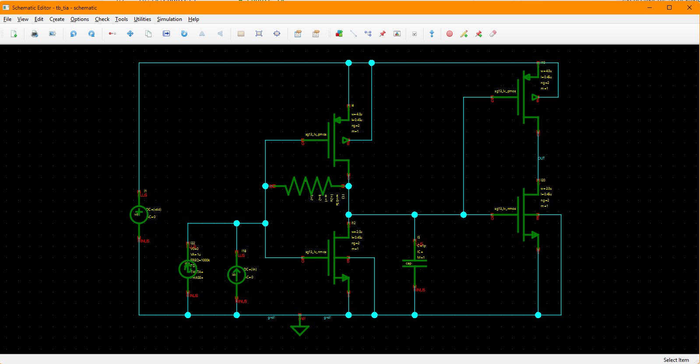
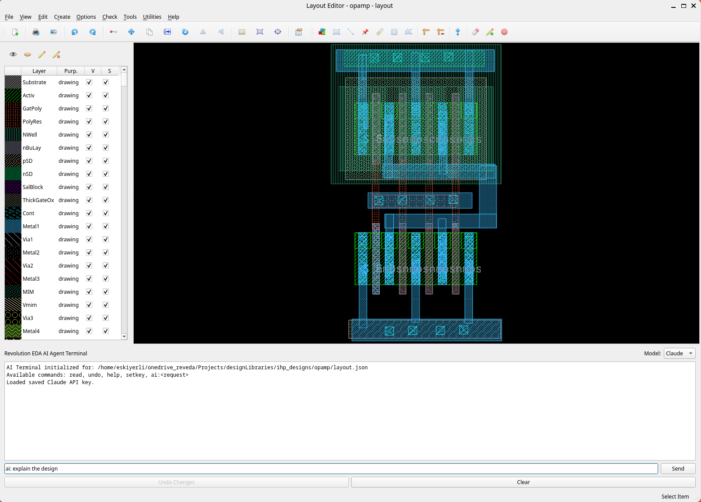
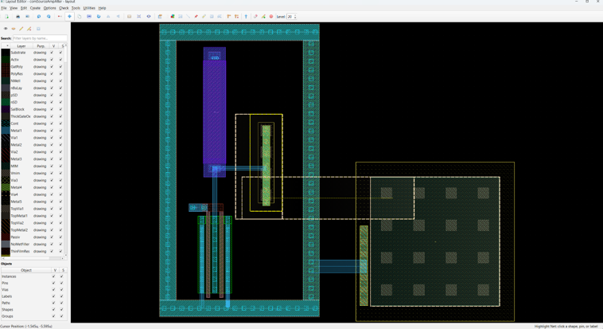

<!-- _class: title -->
<!-- _footer: "Revolution EDA • Decision-maker briefing • September 2026" -->

<div class="kicker">Custom IC design, without a closed workflow</div>

# Give your design team another degree of freedom

<p class="lead"><strong>Revolution EDA</strong> is an open, extensible environment for custom IC schematic, simulation, and layout workflows.</p>

**Executive briefing — 15 slides**

<!--
SPEAKER NOTE: This is not a proposal to replace a qualified production flow overnight. It is an invitation to test a strategic option: a modern, inspectable design environment that can coexist with what the organization already trusts.
VISUAL: Dark background with a subtle chip floorplan or interconnect pattern. Keep the product name and thesis dominant.
-->

---

# The strategic risk is bigger than license cost

<div class="cards">
<div class="card">
<div class="metric">Locked</div>
<h3>Data & workflows</h3>
<p>Opaque formats and vendor-specific automation make change expensive.</p>
</div>
<div class="card">
<div class="metric">Fragmented</div>
<h3>Engineering flow</h3>
<p>Design intent is handed between disconnected capture, simulation, and physical tools.</p>
</div>
<div class="card">
<div class="metric">Constrained</div>
<h3>Innovation</h3>
<p>New methods wait for vendor roadmaps, scarce specialists, or brittle integrations.</p>
</div>
</div>

> The question is not “Can we buy another tool?” It is “Can we preserve strategic control of how we design?”

<!--
SPEAKER NOTE: Avoid invented savings figures. Ask the audience to map these three constraints to their own environment: tool access, integration backlog, reproducibility, and retention of design knowledge.
VISUAL: Three executive-level risk cards, not screenshots.
-->

---

# The proposal: add optionality, not disruption

<div class="columns">
<div>

## Start beside the incumbent flow

- Select a **bounded, non-tapeout-critical** design
- Connect one relevant **PDK and simulator path**
- Reproduce a known result
- Measure engineering effort and workflow fit
- Keep every pilot artifact portable

</div>
<div>

## Earn expansion with evidence

**No forced migration**  
**No proprietary database commitment**  
**No enterprise-wide rollout to approve**

A pilot can answer the real question:

> Where does Revolution EDA create leverage for us now?

</div>
</div>

<!--
SPEAKER NOTE: Lead with reversibility. The decision requested at the end is permission for a controlled evaluation, not a platform standardization decision.
VISUAL: A two-lane diagram: “trusted production flow” continues while a short “Revolution EDA pilot” lane runs beside it and rejoins at a review gate.
-->

---

# One environment across the custom IC loop



- **Schematic & symbol** editing
- Hierarchical, configuration-driven **netlisting**
- Optional **simulation and plotting** plugins
- Hierarchical **layout** with Python PCells
- **GDS and OAS** import/export
- RC parasitic extraction to **SPICE, SPEF, Spectre, and VACASK**
- Project, library, PDK, and plugin management

<p class="small">Current project version: 1.0.0. Optional capabilities depend on installed plugins, PDKs, and external simulators.</p>

<!--
SPEAKER NOTE: Describe the product as a coherent environment, not a claim that every signoff function is internally replaced. External simulators and verification tools remain valid parts of a deployable flow.
VISUAL: Use the real schematic editor screenshot shown on the right.
-->

---

# Design data your organization can inspect

<div class="columns">
<div>

## Human-readable JSON

- Diffable in standard version-control systems
- Scriptable with familiar engineering tools
- Reviewable without a proprietary database reader
- Suitable for automation and reproducible transformations

</div>
<div>

```json
{
  "cellView": "schematic",
  "viewType": "schematic"
}
```

> The design database becomes an accessible engineering asset—not a black box.

</div>
</div>

<!--
SPEAKER NOTE: The value is governance and automation, not hand-editing every design. Inspectable data enables code review patterns, diagnostics, migration tooling, and durable ownership.
VISUAL: Show a clean JSON diff flowing into a schematic thumbnail and a Git review icon.
-->

---

# Integrate where standards already exist

| Boundary | Revolution EDA path | Executive value |
|---|---|---|
| Process enablement | Python-based PDK modules and PCells | Adapt the environment to the process |
| Simulation | Xyce, Spectre, and VACASK netlisting paths | Preserve simulator choice |
| Model intake | Verilog-A and supported subcircuit parsing | Reuse existing model assets |
| Physical exchange | GDS / OAS import and export | Fit established downstream flows |
| Extracted output | SPICE / SPEF / Spectre / VACASK | Connect analysis and verification stages |
| Automation | Python console, JSON, plugin API | Build workflow IP with common skills |

<!--
SPEAKER NOTE: “Supports” does not mean qualification for a specific company flow. The pilot must verify the exact PDK, model, simulator, and exchange path that matters to the sponsor.
VISUAL: Replace the table with a hub-and-spoke graphic if presenting live: Revolution EDA at center, standards and existing tools around it.
-->

---

# A platform, not a fixed appliance

<div class="cards">
<div class="card">
<h3>PDK layer</h3>
<p>Process layers, callbacks, labels, and PCells are supplied through Python packages.</p>
</div>
<div class="card">
<h3>Plugin layer</h3>
<p>Plugins add menus, actions, and custom views without changing core application code.</p>
</div>
<div class="card">
<h3>Automation layer</h3>
<p>An integrated Python console and transparent files expose practical extension points.</p>
</div>
</div>

## Build differentiated workflow IP at your pace

Source and binary plugin models allow **open collaboration** and **controlled commercial extensions** to coexist.

<!--
SPEAKER NOTE: This is the strategic architecture slide. Internal methodology can be expressed in extensions rather than waiting for a monolithic vendor release. Governance still matters: version, test, review, and qualify internal extensions.
VISUAL: Three-layer stack: open core, enterprise workflow extensions, company methodology/PDK.
-->

---

# AI assistance—with a reversible operating model



- Natural-language editing of **schematics, symbols, and layouts**
- Choice of **OpenAI, Google, or Anthropic** backends
- A backup before each AI modification
- One-click restore / undo path
- Direct inspection of design JSON
- Encrypted local storage for API keys

## Treat AI as an accelerator—not an authority

<p class="small">Deployment should follow company policy for model access, design-data handling, review, and approval.</p>

<!--
SPEAKER NOTE: Do not lead with AI hype. The important design choice is reversibility and inspection. In a pilot, AI can be optional and separately governed.
VISUAL: Use the actual AI terminal screenshot. Highlight “backup,” “undo,” and model choice with subtle callouts.
-->

---

# Physical design remains connected to intent



- Hierarchical custom layout
- Rectangles, paths, polygons, pins, labels, and vias
- Python-based parametric cells
- Layer visibility and selectability controls
- Initial schematic-driven layout support
- Connectivity-aware editing and net highlighting
- GDS / OAS exchange and RC extraction path

<!--
SPEAKER NOTE: This establishes that Revolution EDA is not merely a schematic viewer. Be precise: final signoff readiness depends on the target process and external verification flow selected for the pilot.
VISUAL: Use the real layout editor screenshot on the right.
-->

---

# The business case is strategic leverage

<div class="cards">
<div class="card">
<h3>For design leadership</h3>
<p>Another path for prototyping, education, research, smaller programs, and workflow experiments.</p>
</div>
<div class="card">
<h3>For engineering</h3>
<p>One inspectable environment with Python automation and fewer hard boundaries between design stages.</p>
</div>
<div class="card">
<h3>For the enterprise</h3>
<p>Reduced dependence on any single interface, file format, deployment model, or vendor roadmap.</p>
</div>
</div>

> Optionality compounds: every reusable PDK element, plugin, and automation script increases future choice.

<!--
SPEAKER NOTE: This is intentionally a value hypothesis, not a promised ROI. Quantify only after the pilot establishes baseline and observed effort.
VISUAL: A flywheel: adopt → automate → reuse → broaden optionality.
-->

---

# Open core changes the control model

<div class="columns">
<div>

## MPL 2.0 licensed core

- Use for any purpose
- Inspect and modify source
- Distribute under the license terms
- Build commercial services and derivatives

</div>
<div>

## Practical implications

- Audit the implementation
- Preserve access to the core
- Qualify changes internally
- Keep plugins, PDKs, and libraries under their own applicable terms

</div>
</div>

<p class="small">This slide is an operational summary, not legal advice. Legal review should confirm obligations for the organization’s intended distribution model.</p>

<!--
SPEAKER NOTE: Open source does not mean zero cost or zero obligations. It changes what the organization can inspect, control, and continue. Separate core licensing from the licenses of each plugin, PDK, library, and external tool.
VISUAL: “Control” balance scale: inspectability, continuity, and extensibility on one side; governance and qualification on the other.
-->

---

# Address the adoption risks directly

| Leadership concern | Pilot control |
|---|---|
| “Is it production mature?” | Version 1.0.0: evaluate on a bounded use case; do not assume tapeout readiness |
| “Will it disturb the current flow?” | Run side-by-side; exchange only through agreed files and interfaces |
| “Can it support our process?” | Make one target PDK path a pass/fail workstream |
| “Who supports it?” | Name an internal owner; evaluate documentation, issue response, and support options |
| “What about security and IP?” | Apply approved AI settings, dependency review, access controls, and artifact handling |
| “Will it scale?” | Test a representative hierarchy and dataset; record load, edit, netlist, and export behavior |

<!--
SPEAKER NOTE: Credibility comes from acknowledging maturity. This slide turns objections into evaluation criteria rather than debating them abstractly.
VISUAL: Risk register with green “controlled experiment” gates—not checkmarks implying the risks are already closed.
-->

---

# A focused pilot can produce a decision

## Suggested scope: one representative block, one PDK, one simulator path

<div class="cards">
<div class="card">
<h3>1 — Establish</h3>
<p>Install, register the PDK and library, import or recreate the reference design, capture baseline effort.</p>
</div>
<div class="card">
<h3>2 — Exercise</h3>
<p>Edit hierarchy, netlist and simulate, make a layout change, exchange GDS/OAS, test one automation.</p>
</div>
<div class="card">
<h3>3 — Decide</h3>
<p>Compare results, document gaps, estimate ownership needs, and choose stop / extend / adopt.</p>
</div>
</div>

**Deliverables:** reproducible project • verified result comparison • issue log • workflow-fit scorecard • recommendation

<!--
SPEAKER NOTE: Keep timing adaptable to organizational complexity. The purpose is not a polished demo; it is a reproducible evidence package that another engineer can run.
VISUAL: Three gated stages with a decision diamond after stage 3.
-->

---

# Agree on success before the pilot starts

| Dimension | Example evidence—not a preclaimed result |
|---|---|
| Correctness | Netlist and selected simulation outputs agree within an approved tolerance |
| Interoperability | Required model, GDS/OAS, and extracted-netlist paths complete without data loss |
| Productivity | Engineers complete defined edits and automation tasks; effort is recorded against baseline |
| Extensibility | One small plugin, script, PCell, or PDK adaptation is implemented and reviewed |
| Governance | Project is reproducible from controlled source, configuration, and dependency records |
| Adoption | Pilot users identify credible use cases and blocking gaps |

## Score the evidence. Do not grade the demo.

<!--
SPEAKER NOTE: The sponsor should choose tolerances and weights. “Successful” can mean finding a narrow high-value use case; it does not require replacing every incumbent capability.
VISUAL: A simple scorecard with columns for baseline, target, observed, and decision. Populate only after the pilot.
-->

---

<!-- _class: cta -->
<!-- _footer: "Revolution EDA • Proposed next step" -->

# Authorize a controlled evaluation

<p class="lead" style="margin: 0 auto 28px;">Choose one sponsor, one engineering lead, one representative design, and one explicit decision date.</p>

## The ask

**Approve the pilot scope and success criteria—not a migration.**

The downside is bounded.  
The learning is reusable.  
The upside is strategic design freedom.

<!--
SPEAKER NOTE: End on the precise decision required. Offer a short follow-up working session to select the block, PDK, simulator, security posture, owner, and scorecard weights.
VISUAL: Minimal slide. One orange call-to-action button shape: “Select the pilot.”
-->
